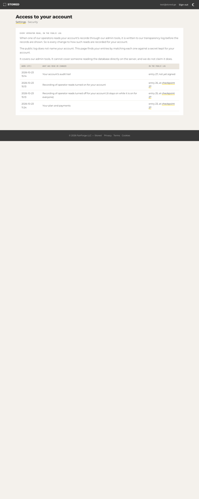

# Stage 1a — Prompt 34b: K4c-2 — cosigned checkpoints and the customer's access view

*2026-10-23. PRs: #924 (K4c-2, cosigned checkpoints, **migration 105** `translog_cosignatures`), #925 (the customer's view), and this docs PR. The next migration is **106**. No `sdk/`, `internal/recovery/`, `cmd/recovery-realm/` or `internal/api/recovery*` file was touched. K5 (#894–#897) and K2b's tail (#906, #907) are other sessions' stacks and are still open; #897 did not merge during this prompt.*

Lane: Trust. This prompt serves `docs/ARCHITECTURE_CONTRACT.md` rule 7: "the log has signed checkpoints and an external witness"; "customers read outcomes; auditors read the log". The plan (43.6) asks for "at least one external witness co-signing every checkpoint".

Two sentences carry this prompt:
- **A witness's statement is in the log's own checkpoint.** The witness cosigns in the public form, and the log collects, verifies and serves every cosignature. A reader can then require N of them, offline.
- **The customer sees its own entries, in words.** It sees what an operator read and when, and the checkpoint that commits to it. The words come from one table, never from free text.

## Step 0

- Prompt 34a is merged and deployed: #922 `83dcfbd5` (Deploy run 39975990767), docs #923 `eff05b2a`, and the WP-P33 post-merge review #921. `ls internal/database/migrations | tail -1` was `104_translog_subjects.sql`.
- Prod baseline at ~17:40 UTC:
  - `/version` `83dcfbd54e7a`, active slot 8001;
  - **0** `"level":"error"` lines in 2 h;
  - `translog_entries` **28**: 24 `server_build` (max idx 24), 2 `admin_read` (idx 23, 27), 2 `log_policy` (idx 25, 26);
  - 0 checkpoints, no signing key, `translog_cosignatures` absent, `TRANSLOG_WITNESSES` not in `.env`;
  - flags: `translog_admin_reads` and `translog_customer_view` ON for tenant zero only (`tenant-4e1b43062db9d685`), no global row;
  - all **16** rule files on the box matched `deploy/monitoring/` hash for hash (`vaultaire-translog.yml` `ab29f19a…`).

## The specs, quoted where relied on

- **c2sp.org/tlog-cosignature**:
  - A checkpoint cosignature is "a statement that the specified tree hash is consistent with all other historical views of the log observed by the cosigner. It is also a statement that, as of the specified time, this is the largest consistent tree the cosigner has observed for the log."
  - Its value is "the timestamp as an eight-byte, big-endian integer" followed by the signature.
  - "ML-DSA-44 SHOULD be used for new deployments." ML-DSA-44 signs `CosignedSubtree{"subtree/v1\n\0", cosigner_name, timestamp, log_origin, start=0, end=size, hash}`.
  - Ed25519 signs the lines `cosignature/v1`, `time <T>`, the origin, the size and the root.
  - "Verifiers MAY reject checkpoint cosignatures with timestamps in the future."
- **c2sp.org/tlog-witness** `add-checkpoint`:
  - The request body: "an old size line, zero or more consistency proof lines, and an empty line, followed by a checkpoint"; "The client MUST NOT send more than 63 consistency proof lines."
  - The witness's codes: 404 for an unknown origin; 403 for "no signature from a trusted key … or a signature line's key name and ID match a trusted key but the signature itself fails to verify"; 400 when the old size exceeds the checkpoint's.
  - On a mismatched old size: "409 Conflict … The response body MUST consist of the tree size of the latest cosigned checkpoint in decimal, followed by a newline … `Content-Type` of `text/x.tlog.size`".
  - 422 for a non-empty proof from 0, a proof that does not verify, or another root at the same size.
  - "The witness MUST persist the new checkpoint before responding", and checking the old size and persisting "must be performed atomically".
  - "The client MUST ignore any signatures from unknown keys … the client MAY concatenate it to the checkpoint, and use a note verification function configured with the witness keys it trusts."
  - The monitor view: `GET <prefix>/<origin hash>/checkpoint`.
- **c2sp.org/signed-note**: a signature line whose key name and ID are known but which fails to verify makes the note malformed. That is why a forged witness line fails `translog-verify` outright, and is never just "one cosignature fewer".
- **c2sp.org/tlog-checkpoint**: the body that is cosigned (origin, size, root). Extension lines are not used.

## K4c-2 (#924) — cosigned checkpoints

| Item | Fix | Red test on `eff05b2a` (main) | Mutation → caught by |
|---|---|---|---|
| 1. The format | `translog.NewCosigner` / `GenerateCosignerKey` (ML-DSA-44 cosignature/v1 via `transparency-dev/formats/note`'s `SubtreeSigner`, timestamp from an injected clock), `NewCosignatureVerifier` (0x04 / 0x06 only; 0x01, the origin's name and a mismatched key ID refused), `OpenCosigned`, `VerifyAnswer`, `CosignatureLines`; `translog-keygen -cosignature` | `TestCosignature_V1_Golden`: does not compile (`undefined: NewCosigner`, `NewCosignatureVerifier`, `VerifyAnswer`). It checks ML-DSA-44 against the spec's `CosignedSubtree`, built by the test and verified with `filippo.io/mldsa` directly: key ID `89692182` = SHA-256(name‖"\n"‖0x06‖pub)[:4], the timestamp bytes = 1679315147. It checks Ed25519 against the spec's `cosignature/v1\ntime …` message, byte for byte (`— witness.example/ed25519 Y9ztVQAAAABkGFDL…DQ==`), and that a tampered time fails | M5 the cosigner ignores its clock → Golden |
| 2. The witness speaks the protocol | `witness.Server` / `translog-witness serve`: `POST /add-checkpoint` with the spec's codes, persisted before the 200; the monitor GET. The pull pass (`-once`) stays. Both read and write `<dir>/checkpoint` through `readHeld` / `accept`, under `lockDir` (`<dir>/lock`, flock) | `TestWitnessServe_AddCheckpoint_Conflict_NamesItsSize`, `TestWitnessServe_BadProof_Refused`: do not compile (`undefined: translog.GenerateCosignerKey`) | M3 no held-size check → Conflict; M4 no consistency proof → BadProof |
| 2. RP42-5 | the lock; the pull pass does not re-cosign a checkpoint it already cosigned | `TestWitnessServe_ConcurrentPassesOneHistoryLine` (16 concurrent pull passes), run alone on main's code: **"expected: 1, actual: 13"**, then 9, then 10 | M1 Pass without the lock → Concurrent; M2 a pull pass re-cosigns an unchanged checkpoint → `TestWitnessServe_SharesStateWithThePullPass` |
| 3. The log collects | `translog_cosignatures` (migration 105). `cosignCollector` in the `translog_checkpoint` job: after a signature, never after a refusal, each due witness of `TRANSLOG_WITNESSES` is sent `add-checkpoint` from the size the log holds a cosignature of. A 409 gets one retry, from the named size. A 200 goes through `VerifyAnswer` against the pinned key, and a future-dated line is refused. The read side appends the newest line per witness key. Outcomes: `job_runs.result.witnesses`, the run's note, a Warn line, `vaultaire_translog_witness_cosign_total{witness,outcome}` | `TestCheckpointJob_CollectsAndServesCosignatures`, `TestCheckpointJob_WitnessDown_StillSigns`: do not compile | M8 the read side drops the lines → Collects; M11 a witness down fails the run → WitnessDown; M9 a refused run submits → `TestCheckpointJob_RefusedRun_SubmitsNothing`; M6 no retry from the named size → `TestCheckpointJob_ConflictRetriedOnceFromTheNamedSize`; M7 an answer kept unverified → `TestCheckpointJob_BadAnswer_NothingKept`; M14 never refreshed and M15 every refresh line served → `TestCheckpointJob_RefreshesAnIdleCosignature` |
| 3. The rule | `TranslogWitnessStale` (warn: witnesses configured, `checkpoint_size > cosigned_size`, newest cosignature > 2 h old, for 10 m), with its promtool tests: firing at 135 m, silent at 110 m, silent for an idle log, silent with no witness | `TestTranslogRules_ParseAndNameExportedSeries` (5 rules, the series exported) | — |
| 4. The verifier side | `translog-verify -witness <vkey> (repeatable) -min N -max-age 24h` through `translog.WitnessPolicy` | `TestVerify_MinCosignatures`: does not compile. It covers a stale line (b at −72 h) not counted, a line of the checkpoint of 11 on the checkpoint of 12, a forged line, no line at all with `-min 1`, `-min` above the keys given, and a plain key refused | M10 a stale cosignature counts → MinCosignatures; M12 a plain note key passes → MinCosignatures |
| 1. The restore still reads the cache | — | `TestRestore_FromCosignatureV1Cache`: does not compile. A cosignature/v1 witness passes at 5 and 9; the dump is at 5; the high-water is the witness's `cosigned` body (case 3); the re-append reaches the root at 9 and the job signs again | M13 the pull pass keeps no bundle → FromCosignatureV1Cache |

All 15 mutations turned their test red. Three were first written as deletions and did not compile (unused variables), so they were run again as compile-safe mutations. Two tests were strengthened after their first mutation survived:
- **M9.** The refused-run test's witness had already cosigned the newest checkpoint, so it was not due. It now signs with the collect step off first.
- **M15.** `note.Open` drops a second line by the same key, so the refresh test now counts the lines in the served bytes.

Also in #924: `docs/TRANSPARENCY.md` § The witness (the two ways in, § The log collects, § Third-party witnesses), § Reading the log (`-witness -min`), § Metrics and alerts, "Cosignatures after a restore"; `internal/translog/CLAUDE.md`.

### Lab: a local server, the WP-P32 recipe

Setup: a private database `vaultaire_p34blab` (every migration through 105). A lab log key (`translog-keygen`, key ID `7a08c3cb`) and a lab witness key (`translog-keygen -cosignature -name witness.lab/mac`, ML-DSA-44, key ID `e16fe87f`). `translog_public` ON in the lab database. `translog-witness serve -listen 127.0.0.1:7380`, and the server on :18034 with `TRANSLOG_WITNESSES="mac http://127.0.0.1:7380 <vkey>"`. A throwaway appender called `logstore.Append` (never committed), and the job was triggered by `POST /api/v1/admin/jobs/translog_checkpoint/run` with a lab admin JWT.

1. **Sign 3.** Boot: `translog witness {"witness":"mac","url":"http://127.0.0.1:7380","key":"witness.lab/mac+e16fe87f"}`; entry 0 is the boot's `server_build`, then 2 ceremonies. The run result is `{"size": 3, "signed": true, "witnesses": {"mac": {"old": 0, "size": 3, "outcome": "ok"}}, …}`. One row: `3|mac|witness.lab/mac+e16fe87f|3263 bytes`. The checkpoint served:
   ```
   stored.cloud/translog/v1
   3
   FNFxw/2iNVDXnLzZLxGw90u/JYC1kUiPKRrpXJ5sOzI=

   — stored.cloud/translog/v1 egjDy7d1lF02tAcTv1kbZKsDMA6hk7J5lR1rB73ctG7kb18/3dkUm8dUnIvzzdmNEKJcuwd0rDKp2CIt3…(121 chars)
   — witness.lab/mac 4W/ofwAAAABq25Tojfie9dSEwCIH4PUL9rOjtm+GKqd5L8yS03qHRv0Iwl9G/oJwoY2scetuA2M25DCDS5KAe+7tXE…(3264 chars)
   ```
   `translog-verify -vkey @log.vkey -witness @w.vkey -min 1 -entry 2`:
   ```
   checkpoint: stored.cloud/translog/v1 size 3 root 14d171c3…3b32 — signature OK
   cosignature: witness.lab/mac+e16fe87f at 2026-10-23T17:10:00Z — OK
   cosignatures: 1 of the 1 required
   consistency: no saved checkpoint (first run) — this one is saved
   entry 2: included OK
   ```
2. **Stop the witness, sign 4.** The run is `ok`. Its note: `witness mac: unreachable (… dial tcp 127.0.0.1:7380: connect: connection refused)`. The result has `"signed": true`, `"witnesses": {"mac": {"old": 3, "size": 4, "outcome": "unreachable", …}}`. The Warn line is `translog witness: no cosignature this run — the checkpoint stays signed`. On `/metrics`:
   ```
   vaultaire_translog_checkpoint_size 4
   vaultaire_translog_cosigned_size 3
   vaultaire_translog_witness_cosign_total{outcome="ok",witness="mac"} 1
   vaultaire_translog_witness_cosign_total{outcome="unreachable",witness="mac"} 1
   vaultaire_translog_witnesses_configured 1
   ```
   `checkpoint_size 4 > cosigned_size 3` with a cosignature that stops aging only when one arrives: `TranslogWitnessStale` fires after 2 h + 10 min. The promtool test on the box proves the expression (§ Prod).
3. **Restart the witness, sign 5.** The result is `"witnesses": {"mac": {"old": 3, "size": 5, "outcome": "ok"}}`. The proof runs 3 → 5; the witness held 3, so the conflict path was not needed. The rows are `3|mac|…11:10:00`, `5|mac|…11:10:32`. `translog-verify … -witness @w.vkey -min 1`: `cosignature: witness.lab/mac+e16fe87f at 2026-10-23T17:10:32Z — OK`, `consistency: size 3 → 5 OK`. After the 15 s scrape cache: `vaultaire_translog_cosigned_size 5`.
4. **One state, two ways in.** A pull pass on the same directory: `… size 5 … consistent with 5, 1 bundle(s) mirrored, cosigned by witness.lab/mac (e16fe87f)`. `cosigned.history` stays at **2** lines (serve's 3 and 5; the pull pass did not re-sign 5), and the cache holds `tile/entries/000.p/5`.

The full `go test -race ./...` on the private DB `vaultaire_p34b` passed (exit 0), and `make lint` reported 0 issues.

## The customer's view (#925) — Settings → Access to your account

| Item | Fix | Red test on `eff05b2a` | Mutation → caught by |
|---|---|---|---|
| The words | `adminread.Words`: ONE table, fixed sentences for the six subject scopes and the six (flag, action, value) writes of a tenant `log_policy`; `Unknown` otherwise | `TestWords_EveryEntryATenantCanFindHasWords`: does not compile (`undefined: Words`) | V9 a scope missing from the table → Words |
| The page | `GET /dashboard/settings/access` (`HandleAccess`): `AccessLog.Find` (the API's `adminread.Store`), newest first, "entry N, at checkpoint M" linked to `<trust>/translog/checkpoint`, or "not yet signed", `no-store` | `TestAccessPage_ListsOnlyTheTenantsOwnRows` (two tenants on a private log, a signed checkpoint): does not compile | V2 `Find` skips the commitment check → ListsOnly; V7 oldest first → ListsOnly |
| The flag | `translog_customer_view` per tenant (ON wins), OFF or no flags = 404 `no-store` and the log is never read; the Settings card only while on | `TestAccessPage_FlagOff_404`, `TestAccessRoute_ThroughTheDashboardRouter` (no flags / OFF / ON through `RegisterRoutes`): do not compile (`unknown field AccessLog`) | V1 the page ignores the flag → FlagOff; V4 the route ungated → Route; V5 the card always shown → Route |
| Escaping | the words come from the table, never the entry; the URL attribute is escaped by `html/template` | `TestAccessPage_EscapesHTML` (a `<script>` scope; a quote in the trust URL → `href="https://trust.example/x%22%3e%3cscript%3e…"`) | V3 the raw scope instead of the words → Escapes |
| Honesty | while `translog_admin_reads` is off for the tenant the page says reads are not being recorded; a log that cannot be read is an error line, never "none recorded" | `TestAccessPage_LogUnreadable_SaysSo` | V6 the page claims recording → ListsOnly (B's warning); V8 "none recorded" on an error → LogUnreadable |

All 9 mutations turned their test red. `make dash-shots` (run on the private DB) renders `access-light`, `access-dark` and `access-phone` in the pixel design. The phone width has no horizontal scroll.



## Prod proof

Two deploys, both through the merge queue, each with its own Deploy run:
- #924 merged as `818f4d0f` (Deploy run 39998288693, `/version` `818f4d0fef06`, slot 8000);
- #925 merged as `7efa38bb` (Deploy run 40000160025, `/version` `7efa38bbed2e`, slot 8001).

The final build at ~18:00 UTC was read with the box-script recipe. Every admin or tenant call used a 10-minute JWT minted on the box from `JWT_SECRET`, never printed (D-P33-20). Only tenant zero (`tenant-4e1b43062db9d685`) and the bench tenant (`tenant-14a623b16b3f7012`) were read.

- **`TRANSLOG_WITNESSES` unset is a no-op:**
  - **0** `"level":"error"` lines since either deploy;
  - the boot's Info line: `translog witnesses: none — checkpoints are signed and not submitted to any witness`;
  - on the slot's `/metrics`: `vaultaire_translog_witnesses_configured 0`, `vaultaire_translog_cosigned_size 0`, `vaultaire_translog_cosignature_timestamp_seconds 0`, and no `vaultaire_translog_witness_cosign_total` series (D-P34b-4: they are created per configured witness);
  - the `translog_checkpoint` job: `ok`, `no signing key`, with no `witnesses` key in its result.
- **Migration 105 applied:** `translog_cosignatures` exists with 0 rows, and its triggers `translog_cosignatures_append_only` and `translog_cosignatures_no_truncate` are in place.
- **The log:** 30 entries. 26 `server_build` (each deploy appended its own, idx 28 and 29), 2 `admin_read` (23, 27), 2 `log_policy` (25, 26). Nothing else was appended by the proof.
- **Tenant zero's view** (`GET /api/v1/manage/account/transparency`, the same `adminread.Find` the page reads) lists **idx 23** (`admin_read` `tenant_payments`) and Prompt 34a's **25** and **26** (`log_policy`, `translog_admin_reads`, set false, then set true), plus **27** (`admin_read` `tenant_audit`). `checkpoint_size` is null for each (no signing key yet). On the page these read, newest first:
  - "Your account's audit trail";
  - "Recording of operator reads turned on for your account";
  - "Recording of operator reads turned off for your account (it stays on while it is on for everyone)";
  - "Your plan and payments";
  each one "not yet signed".
- **The bench tenant** (flag OFF): **404** `{"error":{"type":"not_found_error","code":"not_found",…}}`.
- **The page's route** with no session: `GET /dashboard/settings/access` → **303** to `/login`. The route is mounted behind the session gate; the page itself is proven against the production router in tests (D-P34b-14).
- **Flags unchanged:** `translog_admin_reads` and `translog_customer_view` are ON for tenant zero only; there is no global row.
- **Rules.** `vaultaire-translog.yml` and its test were copied into one directory on the box:
  - `promtool test rules vaultaire-translog_test.yml` gave **SUCCESS**, and `promtool check rules` reported `5 rules found`;
  - `install -m 0644` into `/etc/prometheus/rules/`, then `systemctl reload prometheus` (active);
  - `/api/v1/rules` names `TranslogWitnessStale`;
  - sha256 `vaultaire-translog.yml` `bf955269e90dc1182cd30b9c45b75df61bdc70e93dc9a1fae0d54a1903cc5f61` (= the installed file = main's) and `vaultaire-translog_test.yml` `6830ff6363bd2efac70555c3e23d277dce4c39355f77e70973eecc517d4810fa`;
  - the other 15 rule files are unchanged from Step 0.

## Departures (D-P34b-n)

- **D-P34b-1.** **Our witness key is ML-DSA-44 only** (the spec's SHOULD, and post-quantum). The log and readers also accept 0x04 Ed25519, which is what the public witnesses use. The plain-note witness line is **dropped**, not kept for a release. No witness ever ran against prod, because there is no signing key, so nothing needs migrating. `Witness.Pass` still accepts any `note.Signer` (the old tests use one); the CLI accepts only a cosignature/v1 key. A K4b cache and `cosigned` stay readable: `translog-restore` reads only the cache, and case 3 reads only the note's body.
- **D-P34b-2.** **Migration 105 is a table, not a column.** Migration 103's trigger refuses UPDATE on `translog_checkpoints`, so a column could not be "written once" after the row, and a refresh is a second cosignature of the same checkpoint. Uniqueness is on `(checkpoint_size, md5(line))`, because an ML-DSA-44 line (~3.3 KB) is past a btree row's 2,704-byte limit (the first lab run failed on exactly that). md5 is a dedup key here; every line is verified under its pinned key before it is kept.
- **D-P34b-3.** **The job refreshes an idle checkpoint's cosignature after 6 h.** This is not in the prompt. A cosignature is timestamped, so a reader with a max age (`translog-verify -max-age`, default 24 h) would otherwise refuse a log that has not grown in a day. It costs ≤ 4 more requests per day per witness, which is counted in the `qpd` asked of the public network.
- **D-P34b-4.** **`vaultaire_translog_witness_cosign_total` is pre-created at boot, not in `init()`.** Its `witness` label exists only in `TRANSLOG_WITNESSES`, so `SetWitnesses` creates every (witness, outcome) series at 0 when the list is read. With the list unset (prod), the family has no series. `vaultaire_translog_witnesses_configured` (0), `_cosigned_size` and `_cosignature_timestamp_seconds` (0, read on scrape) are always exported.
- **D-P34b-5.** **`TRANSLOG_WITNESSES` format:** witnesses separated by `;` or newlines, each `<name> <url> <vkey>`.
  - Validation is all or none: a list that does not validate gives one Error line and no witness, like `SYNC_WEBDAV_URLS`.
  - https only, except http to a loopback host (a lab); at most 8 witnesses.
  - Plain env: the protocol has no authentication beyond the checkpoint's signature, so there is no token to read like a secret.
- **D-P34b-6.** **`serve` does not mirror.** The pull pass does, from cron beside it. A serve-only witness's `cosigned` can be ahead of its cache. `translog-restore` then names the missing bundle and refuses, which is the loud failure. The window is the cron's interval, the same as K4b's.
- **D-P34b-7.** The pull pass does not re-cosign a checkpoint it has already cosigned: a timestamped cosignature would add a history line every run. `serve` always signs anew, because a request for the same size is the log's refresh.
- **D-P34b-8.** **The 409 retry** happens once, and only when the named size is at most the log's newest checkpoint and differs from the old size sent. A named size larger than the newest checkpoint is a `conflict`, with a Warn line naming a restore or a fork. A 5xx or no answer is `unreachable`; another 4xx is `refused`.
- **D-P34b-9.** **`translog-verify`:**
  - `-witness` is repeatable; `-min` defaults to 1 with any `-witness`; `-max-age` defaults to 24 h; the future skew is fixed at 5 min.
  - A line that claims a listed key and does not verify fails the whole run (signed-note: the note is malformed), never "one fewer".
  - Without `-witness`, the run is K4's, unchanged.
- **D-P34b-10.** **A new module**, `filippo.io/mldsa` (`v0.0.0-20260215214346-43d0283efc3e`). `transparency-dev/formats/note` requires it, and `formats` was already in `go.mod`. It is linked into `cmd/vaultaire`, which verifies ML-DSA cosignatures.
- **D-P34b-11.** **The words are a Go map in `adminread`, not a JSON file like `modes.json`.** The scopes and flags are Go constants, and the test walks `AdminReadScopes()` and `PolicyFlags()`. `translog_public` has no tenant words: a tenant row of it is refused (D-P34a-4).
- **D-P34b-12.** **The page reads `translog_admin_reads` too.** "Every operator read is written first" is true only while that flag is on for the tenant, so otherwise the page says reads are not being recorded. The prompt did not ask for this; rule 8's spirit (claim nothing we do not do) did.
- **D-P34b-13.** **The route is `/dashboard/settings/access`**, linked from a card on Settings. The dashboard has no Settings → Security subpage; sessions and 2FA are cards on the one Settings page, and `docs/surfaces/CONSUMER.md` / `DEVELOPER.md` name no place for it.
- **D-P34b-14.** **The prod view was read through the API**, not the page (D-P33-20). The page needs tenant zero's dashboard session, which means the owner's TOTP, and minting a session would bypass MFA. Both read the one `adminread.Find`, and the page is proven against the production router in tests and in the screenshots.

## Residuals (RP45b-n)

| # | Sev | What | Where |
|---|---|---|---|
| RP45b-1 | note | The collected cosignatures are our own witness's until a third party accepts the log. RP41-3 is closed **in part**: the protocol, the collection and the reader's `-min` exist; an independent cosigner does not | owner items |
| RP45b-2 | note | `serve` keeps no byte cache (D-P34b-6). A witness run only as `serve` cannot feed `translog-restore` | witness |
| RP45b-3 | note | A refresh adds one `translog_cosignatures` row per witness per 6 h while the log is idle (~1.5k rows a year per witness). Append-only, never pruned | translog |
| RP45b-4 | note | `translog_cosignatures` comes back with a dump. After a restore, the log's record of each witness is the dump's: the first submission after the re-append costs a 409 and a retry | translog |
| RP45b-5 | note | The page's link points at `trust.stored.cloud/translog/checkpoint`, which is 404 while `translog_public` is OFF and the trust host does not resolve (RP41-2). The entry and checkpoint numbers are right; the link is dark until the owner's flips | dashboard |
| RP45b-6 | note | `lock_other.go` refuses on non-unix systems: the witness runs on the Mac and Linux only | witness |

**Carried:**
- RP43-2 (the salt in plaintext: wrap it with F-14 or the broker), RP43-3 (`Find` is linear; the page now calls it per view), RP43-5 (as RP45a-5), RP43-7, RP43-8, RP43-9 (`TenantOfUser` by e-mail), RP43-11, RP43-12.
- RP44-5; RP45a-1…6; RP41-1; RP41-3 (in part, RP45b-1).
- RP38-2…4, RP38-7…9; RP34-2, -5, -8, -10, -12; RP35-2…5; RP37-16; RP39-* (Prompt 31's); RP36-* (Prompt 29's).

**Closed:** RP42-5 (the lock, #924), RP43-10 (the view, #925).

## Owner items (note only)

- **The signing-key ceremony**, and publishing the verifier key outside our infrastructure **and on a `stored.cloud` page**. Glasklar asks for proof of the key's name, and the Witness Network asks for a stable origin and key.
- **`trust.stored.cloud`** DNS (proxied), the origin certificate's SAN, and `TLS_CERT_PROBE_TARGETS` (RP41-2).
- **The witness on the Mac, after the ceremony.**
  1. `translog-keygen -cosignature -name witness.<host>`.
  2. The pull pass from cron (the byte cache).
  3. Optionally, `translog-witness serve` behind a stable https URL.
  4. Then set `TRANSLOG_WITNESSES="mac https://<url> <vkey>"` in `/opt/vaultaire/configs/.env` and run `sudo vaultaire-switch restart`.
- **Third-party witnesses** (K4c-2 item 7; `docs/TRANSPARENCY.md` § Third-party witnesses, researched 2026-10-23). Both networks are push; our collect step is the client.
  1. **The Witness Network**:
     - e-mail `participate@lists.witness-network.org` with the origin `stored.cloud/translog/v1`, the vkey (0x01 Ed25519, named for the origin), `qpd 300`, the **staging** list, a contact, the purpose, and the checkpoint and tile URLs;
     - once listed, add each participating witness's prefix and 0x04 key to `TRANSLOG_WITNESSES`;
     - never change the origin or the key, and never exceed the `qpd`.
  2. **Glasklar** (Sigsum): e-mail `witness-registry@glasklarteknik.se` with:
     - the vkey;
     - proof that we control the name (the vkey on a `stored.cloud` page);
     - the submission rate;
     - the bastion question (it is reached through a C2SP https-bastion: ask which one);
     - a contact.
     Expect an answer within three working days.
- F-33.
- RB-3: `BLOMP_ALLOW_UNSEALED` off before customers.
- **`translog_admin_reads` global ON** (`docs/TRANSPARENCY.md` § Before the global flip). Then `translog_customer_view` global ON, so every customer has the page.
